# DocFlow

Upload a supplier invoice PDF, digital or scanned. DocFlow reads it, checks it, lets a person approve it, and then creates the bill in Zoho Books.

**Live demo:** https://docflow.ochiengherman.com (passcode protected to limit api use; passcode sent in email)

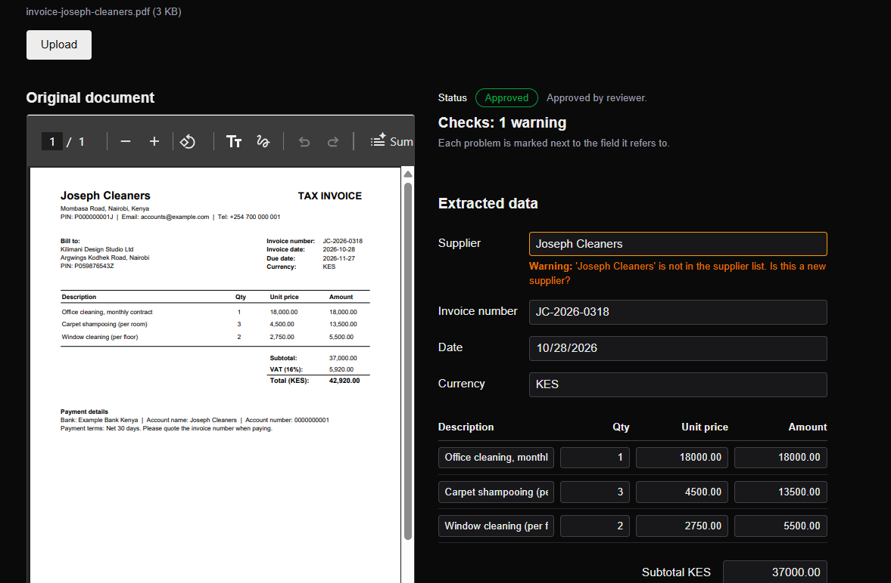

## What it is and why

Invoices arrive as PDFs and someone usually retypes them into the accounting system by hand. That is slow, and typing mistakes are easy to miss.

DocFlow does the reading and the first round of checking, and keeps a person in charge of the decision:

- Claude reads the invoice and pulls out the supplier, invoice number, date, currency, line items and totals.
- The app checks the result: the maths, the dates, whether the supplier is known, and whether the invoice was uploaded before.
- A reviewer fixes anything wrong, then approves or rejects. Every step is recorded.
- An approved invoice becomes a bill in Zoho Books, once and only once.

## How it fits together

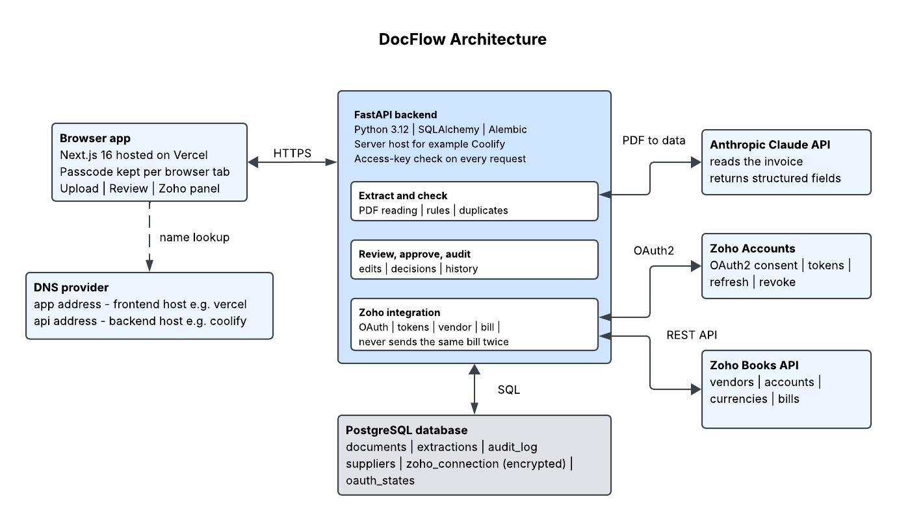

- **Browser app (Next.js):** the screens for upload, review and the Zoho panel. It asks for a passcode before anything else.
- **Backend (FastAPI):** reads the PDF, runs the checks, saves decisions, and talks to Zoho. Every request must carry the passcode.
- **Anthropic Claude API:** turns the invoice into structured fields.
- **PostgreSQL:** stores documents, extractions, suppliers, the audit trail, and the saved Zoho connection (encrypted).
- **Zoho Accounts:** handles the sign-in (OAuth2) that lets DocFlow act for you.
- **Zoho Books API:** where the vendor and the bill are created.

## Walkthrough

### 1. Private access

The demo asks for a passcode before it shows anything. The app calls a paid AI service and can write to a real accounting system, so it should not be open to anyone who finds the link. The backend checks the passcode on every request, not just in the browser.

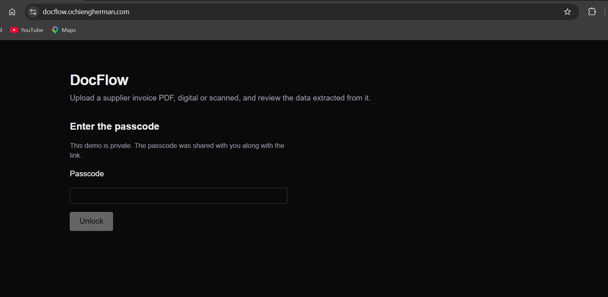

### 2. Connect Zoho

Press **Connect Zoho** and Zoho asks you to allow DocFlow to create bills and vendors. The saved access is encrypted in the database, refreshes by itself, and is removed when you press **Disconnect**.

| Not connected | Zoho asks for permission | Connected |
|---|---|---|
| 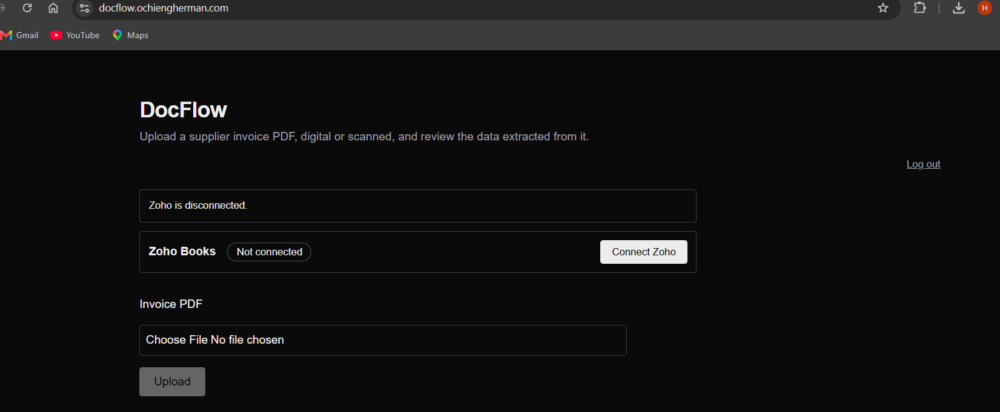 | 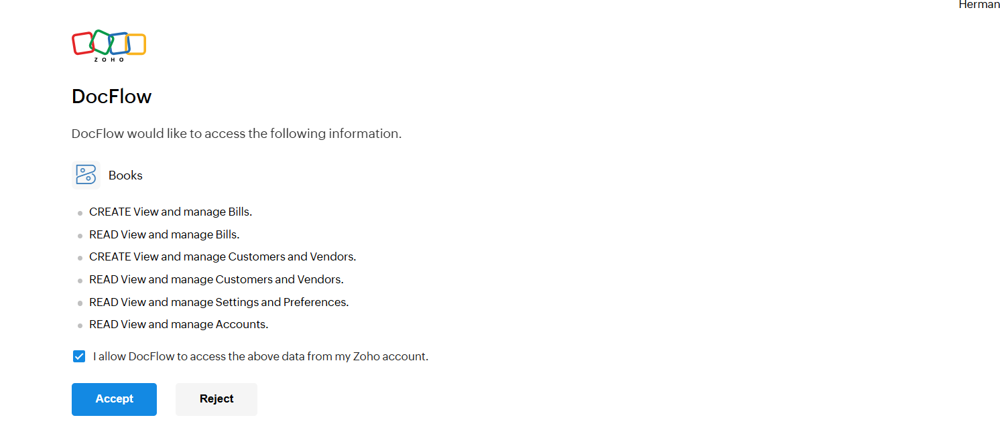 | 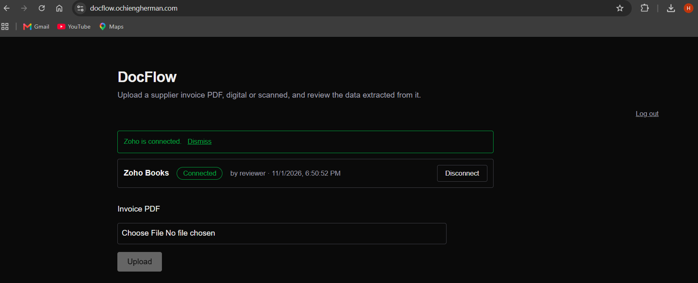 |

### 3. Upload an invoice

Choose a PDF. It can be a normal digital PDF or a scanned image saved as PDF. The original stays on screen next to the extracted data, so the reviewer can compare them.

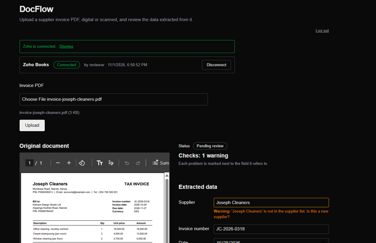

### 4. Checks and review

Each problem is marked next to the field it belongs to. In this example the supplier is not in the known list, so the app asks "Is this a new supplier?". The app also checks:

- the lines add up to the subtotal, and subtotal plus tax equals the total
- the date is valid and not too old
- the supplier is on the list, with a suggestion if the spelling is close
- the same file or the same invoice was not uploaded before

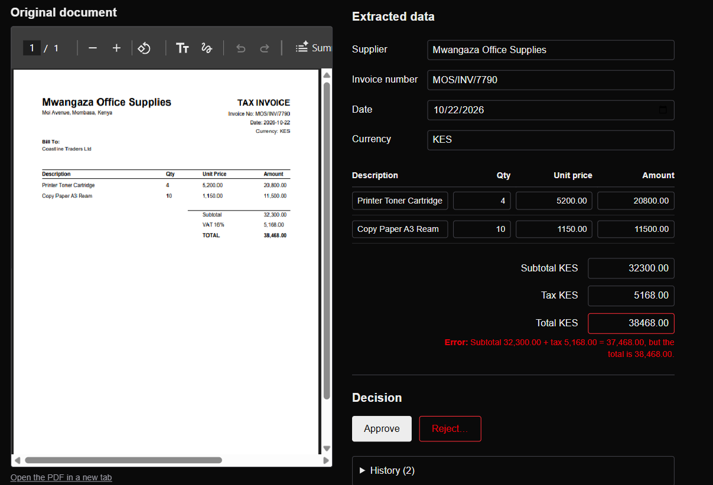

We can edit any value, and the checks update straight away.

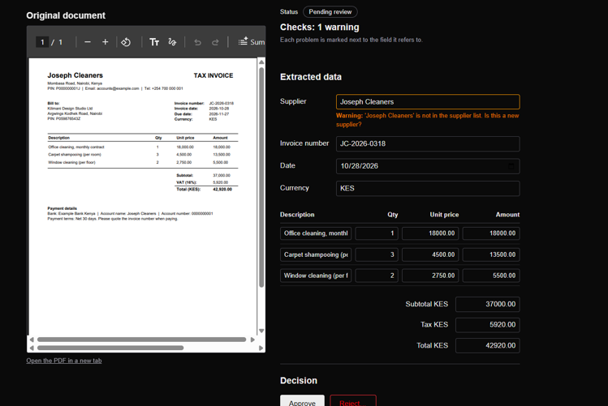

### 5. Approve or reject

A reviewer approves, or rejects with a reason. A new supplier is added to the list when you approve. Once decided, the invoice is locked.


### 6. Send to Zoho, once

The **Send to Zoho** button appears only on approved invoices. It creates the vendor if needed, then the bill, and shows an **Open in Zoho Books** link. The History panel records who sent it and when.

Sending twice never creates a second bill:

- the invoice is locked while it is being sent
- an invoice that was already sent returns its existing bill
- before creating, DocFlow asks Zoho whether a bill with the same vendor and number already exists, so a crash or a lost reply cannot cause a duplicate

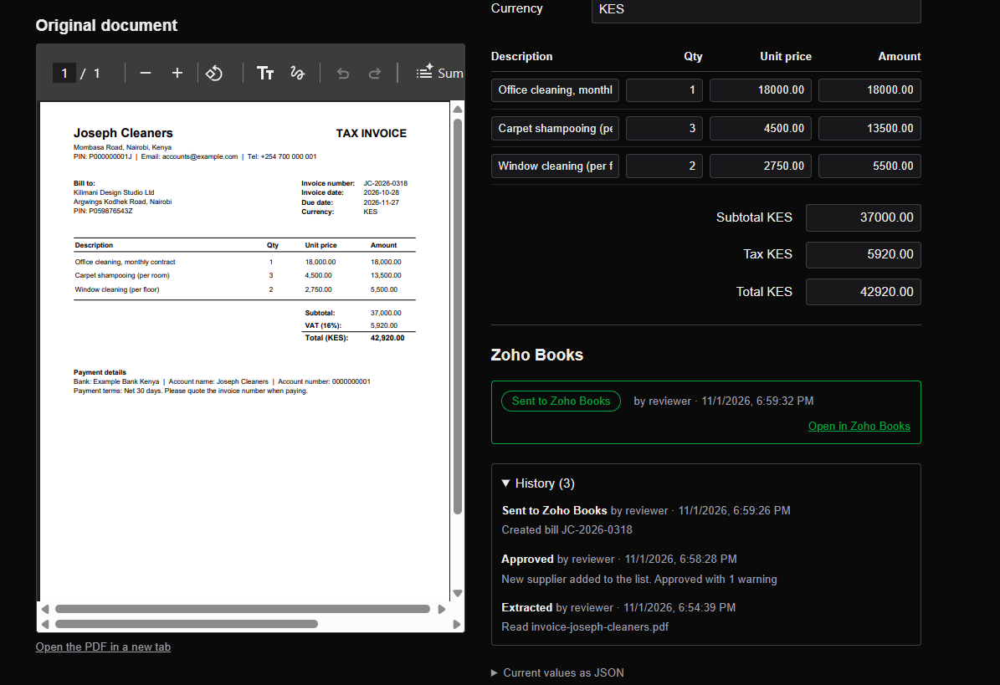

### 7. The bill in Zoho Books

The bill has the same vendor, number, date and currency as the invoice. Tax is its own line, and the bill total always equals the invoice total. If the numbers cannot be made to match, the invoice is refused with a clear reason instead of sending a wrong bill.

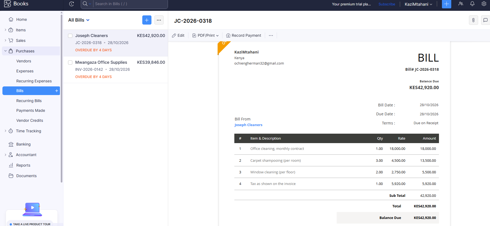

## Tests

```bash
cd backend && uv run pytest -q     # 901 tests
cd frontend && npx eslint app lib
```

- The backend tests cover the extraction rules, every check, the approval steps, the database migrations, the Zoho sign-in, and the bill sending. Zoho is replaced by a fake in the tests, so no real account is touched.
- The sample invoices in `backend/samples/` trigger each check: wrong total, missing date, misspelled supplier, poor scan, and a re-scanned duplicate.
- The Zoho sending is tested for the case that matters most. Sending the same invoice twice, and sending after a failed attempt, both leave exactly one bill.

## Run it yourself

You need Python 3.12, [uv](https://docs.astral.sh/uv/), Node.js, a PostgreSQL database (Neon has a free one), an Anthropic API key, and a Zoho Books account.

**1. Create a Zoho client.** In the [Zoho API Console](https://api-console.zoho.com), add a *Server-based Application*. Set the redirect address to `http://localhost:8000/integrations/zoho/callback`. Keep the client ID and secret.

**2. Backend**

```bash
cd backend
cp .env.example .env        # then fill in the values from the table below
uv sync
uv run alembic upgrade head
uv run python -m scripts.seed_suppliers
uv run uvicorn main:app --reload
```

**3. Frontend** (in a second terminal)

```bash
cd frontend
cp .env.example .env.local  # NEXT_PUBLIC_API_URL=http://localhost:8000
npm install
npm run dev
```

Open http://localhost:3000, enter your `ACCESS_KEY`, and press **Connect Zoho**.

### Settings

| Setting | What it is |
|---|---|
| `ANTHROPIC_API_KEY`, `ANTHROPIC_MODEL` | reads the invoices |
| `DATABASE_URL` | the PostgreSQL address |
| `ACCESS_KEY` | the passcode for the app (at least 16 characters) |
| `FRONTEND_ORIGIN` | the one web address allowed to call the API |
| `ZOHO_CLIENT_ID`, `ZOHO_CLIENT_SECRET` | from the Zoho API Console |
| `ZOHO_REDIRECT_URI` | must match the address registered in Zoho exactly |
| `ZOHO_ACCOUNTS_URL` | `https://accounts.zoho.com` (use your own data centre's address if different) |
| `ZOHO_ORGANIZATION_ID` | your Zoho Books organization ID |
| `TOKEN_ENCRYPTION_KEY` | a key that encrypts the saved Zoho access |
| `ZOHO_EXPENSE_ACCOUNT_ID` | optional: force the expense account used on bill lines |

Make an encryption key with:

```bash
uv run python -c "from cryptography.fernet import Fernet; print(Fernet.generate_key().decode())"
```

### API

| Endpoint | What it does |
|---|---|
| `POST /extract` | upload a PDF and get the checked data |
| `PUT /documents/{id}` | save the reviewer's edits |
| `POST /documents/{id}/approve` and `/reject` | decide |
| `POST /documents/{id}/send-to-zoho` | create the bill, once |
| `GET /documents` and `/documents/{id}/audit` | the list and the history |
| `/integrations/zoho/...` | connect, status, disconnect |

### Deploying

- **Backend:** any host that runs Python. I used Coolify with Nixpacks, base directory `backend`, port 8000, and this start command:
  `uv run alembic upgrade head && uv run uvicorn main:app --host 0.0.0.0 --port 8000`
- **Frontend:** Vercel, root directory `frontend`, with `NEXT_PUBLIC_API_URL` set to the backend address.
- **Zoho:** register the live redirect address (`https://<your-api-address>/integrations/zoho/callback`) in the API Console and use the same value for `ZOHO_REDIRECT_URI`. It must be https.
- **DNS:** if you use Cloudflare, set the records to "DNS only" so the hosts can issue their own certificates.

## Limits and next steps

- **Real user login.** The passcode only keeps strangers from using the API. Everyone who knows it is the same user ("reviewer"). Next step: individual accounts with sign-in, so History shows the real person and different roles can be allowed (for example, only managers can send to Zoho).
- The invoice due date is not read yet, so Zoho shows the bill as due on receipt.
- Credit notes are not supported yet. DocFlow refuses to send them to Zoho rather than create a wrong bill.
- One Zoho organization and one allowed web address.